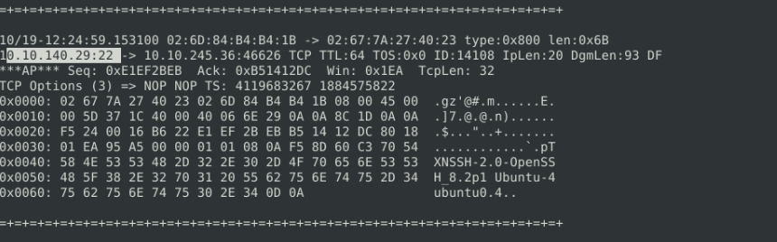
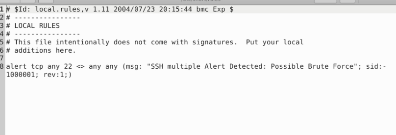
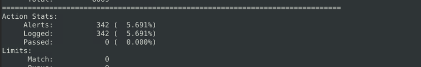
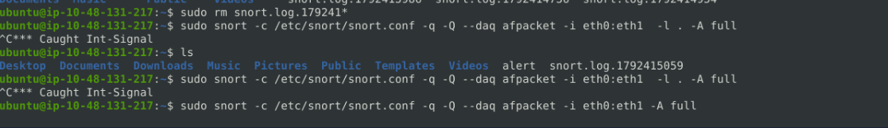
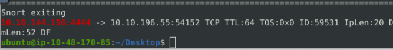
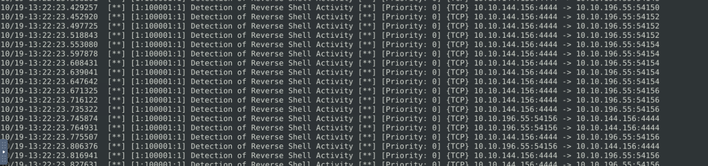
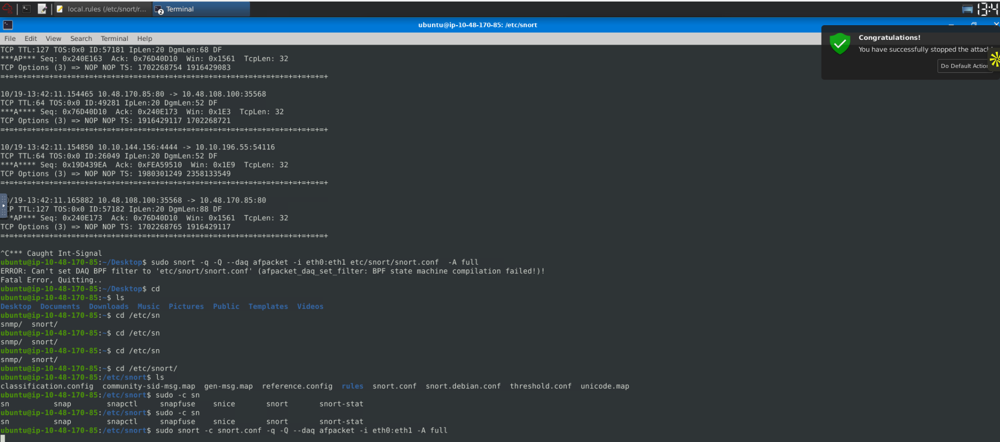
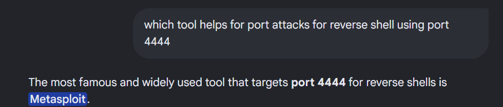

# Snort Challenge - Live Attacks

## Scenario Description


<center> </center>

J&Y Enterprise is one of the top coffee retails in the world. They are known as tech-coffee shops and serve millions of coffee lover tech geeks and IT specialists every day. They are famous for specific coffee recipes for the IT community and unique names for these products. Their top five recipe names are:

**WannaWhite, ZeroSleep, MacDown, BerryKeep and CryptoY.**

J&Y's latest recipe, "Shot4J", attracted great attention at the global coffee festival. J&Y officials promised that the product will hit the stores in the coming months. The super-secret of this recipe is hidden in a digital safe. Attackers are after this recipe, and J&Y enterprises are having difficulties protecting their digital assets.

Last week, they received multiple attacks and decided to work with you to help them improve their security level and protect their recipe secrets. This is your assistant J.A.V.A. (Just Another Virtual Assistant). She is an AI-driven virtual assistant and will help you notice possible anomalies. Hey, wait, something is happening...

---

### The Brute Force Attack 
<center>

</center>
Use the attached VM to finish this task.

**[+] THE NARRATOR:** J&Y Enterprise is one of the top coffee retails in the world. They are known as tech-coffee shops and serve millions of coffee lover tech geeks and IT specialists every day. 


They are famous for specific coffee recipes for the IT community and unique names for these products. Their top five recipe names are; *WannaWhite, ZeroSleep, MacDown, BerryKeep and CryptoY.*


J&Y's latest recipe, **"Shot4J"**, attracted great attention at the global coffee festival. J&Y officials promised that the product will hit the stores in the coming months. 


The super-secret of this recipe is hidden in a digital safe. Attackers are after this recipe, and J&Y enterprises are having difficulties protecting their digital assets.


Last week, they received multiple attacks and decided to work with you to help them improve their security level and protect their recipe secrets.  


This is your assistant J.A.V.A. (Just Another Virtual Assistant). She is an AI-driven virtual assistant and will help you notice possible anomalies. Hey, wait, something is happening...


**[+] J.A.V.A.:** Welcome, sir. I am sorry for the interruption. It is an emergency. Somebody is knocking on the door!


**[+] YOU:** Knocking on the door? What do you mean by "knocking on the door"?


**[+] J.A.V.A.:** We have a brute-force attack, sir.


**[+] THE NARRATOR:** This is not a comic book! Would you mind going and checking what's going on! Please... 


**[+] J.A.V.A.:** Sir, you need to observe the traffic with Snort and identify the anomaly first. Then you can create a rule to stop the brute-force attack. GOOD LUCK!

---

**Question:** First of all, start Snort in sniffer mode and try to figure out the attack source, service and port. Then, write an IPS rule and run Snort in IPS mode to stop the brute-force attack. Once you stop the attack properly, you will have the flag on the desktop!

*Here are a few points to remember:*

- Create the rule and test it with "-A console" mode. 
- Use "-A full" mode and the default log path to stop the attack.
- Write the correct rule and run the Snort in IPS "-A full" mode.
- Block the traffic at least for a minute and then the flag file will appear on your desktop.
- Stop the attack and get the flag (which will appear on your Desktop)

**Answer:**

First we will start to sniff the traffic and start to get what we want which is data which we can use to analyze: 
```
snort -devX -i eth0 -l .  

```




We got the port and we got the protocol used lets now, create an alert, test if it runs, and then drop it. After writing the rule and running against the log file this is what we get: 



**Command:** 

```
sudo snort -devX -c /etc/snort/snort.conf -r snort.log.1792412698 -l . -A console 
```



Now we will drop these packets from ssh itself, and create a new rule: 

**Rule:** drop tcp any 22 <> any any (msg: "SSH Brute Force Dropped"; sid:1000002; rev:1;)

**Command:** sudo snort -c /etc/snort/snort.conf -q -Q --daq afpacket -i eth0:eth1 -A full



You cannot log it to your current directory make sure to log in the default directory, and now you get the flag:

**Flag:** THM{81b7fef657f8aaa6e4e200d616738254}

**Question:** What is the Name Under Attack?

**Answer:** SSH

**Question:** What is the used protocol/port in the attack?

**Answer:** TCP/22

### The Reverse Shell Attack

**[+] THE Narrator:** Good Job! Glad to have you in the team!


**[+] J.A.V.A.:** Congratulations sir. It is inspiring watching you work.


**[+] You: Thanks team. J.A.V.A. can you do a quick scan for me? We haven't investigated the outbound traffic yet. 


**[+] J.A.V.A.:** Yes, sir. Outbound traffic investigation has begun. 


**[+] THE Narrator:** The outbound traffic? Why?


**[+] YOU: We have stopped some inbound access attempts, so we didn't let the bad guys get in. How about the bad guys who are already inside? Also, no need to mention the insider risks, huh? The dwell time is still around 1-3 months, and I am quite new here, so it is worth checking the outgoing traffic as well.


**[+] J.A.V.A.:** Sir, persistent outbound traffic is detected. Possibly a reverse shell...


**[+] YOU: You got it!


**[+] J.A.V.A.:** Sir, you need to observe the traffic with Snort and identify the anomaly first. Then you can create a rule to stop the reverse shell. GOOD LUCK

----

Possible Reverse Shell Attacks researched

**1. Common Outbound Ports (To Bypass Firewalls)**

Most firewalls strictly block unknown incoming traffic, but they are often very permissive with outbound traffic so internal users can browse the web. Attackers exploit this by hosting their listener on standard, trusted ports:

- **Port 443 (HTTPS):** The most common choice. Firewalls expect deep, encrypted traffic to flow out of the network on port 443. A reverse shell running over port 443 looks identical to an employee browsing a secure website.

- **Port 80 (HTTP):** Used because almost all firewalls allow unrestricted outbound web traffic on this port.

- **Port 53 (DNS):** Firewalls must allow DNS queries out of the network to resolve domain names. Advanced reverse shells can tunnel shell commands directly inside fake DNS queries over port 53.


**2. Arbitrary High Ports (For Internal/Lab Testing)**

In capture-the-flag (CTF) environments, malware labs, or networks without strict outbound firewall filtering, attackers will use easy-to-remember, non-standard high ports:
- Port 4444: The default listener port for the Metasploit Framework (a highly popular penetration testing tool).

- Port 1337: A common joke port ("Leet") frequently used in cybersecurity training challenges and walkthroughs.

- Ports 9001 or 8080: Frequently used when spinning up a quick Netcat listener (nc -lvnp 9001).


Lets start to sniff for traffic: 

```
snort -devX -l .
```

Now lets run via the conf file and we will run it over some commonly known ports using: 53, 443, 80, 22

These networking ports gave no results, so now we try using the ctf ports for reverse shelling: 

4444, 1337

After multiple trial and error of ports, we get 4444




Now we add our rules in local.rules and verify if the rules are running properly...

**Rules:** alert tcp any 4444 <> any any (msg: "Detection of Reverse Shell Activity"; sid:100001; rev:1;)


**Command:** sudo snort -c /etc/snort/snort.conf -r snort.log.1792416136 -A console

The rule gets detected successfully



Now just copy the rule paste it and modify the rule and voila we will get the flag: 

**Command:** sudo snort -c snort.conf -q -Q --daq afpacket -i eth0:eth1 -A full



**Flag:** THM{0ead8c494861079b1b74ec2380d2cd24}


This helps us to answer the question of which service and port and we get the answer: 

**Question: What is the used protocol/port in the attack?**

**Answer:** tcp/444

**Question:** Which tool is highly associated with this specific port number?

**Answer:** Metasploit




## Room Takeaways

<p> This room was far more interesting and something like a real-world problem kind of scenario. It really tested me and the capabilities I have with this tool. 

Helped me to analyze way loads of packets, help me get clear with many Linux CLI commands, made me analytical and thoughtful, and made me to make the commands as a tool I should be able to use via the cli for a better understandning. This makes me also ponder on various ways I can create multiple rules in multiple ways, and I would probably make another write for the same challenge because the appraoch I want to try to make this challenge work in a real-life scenario should work out if we configure this rule in another way.
